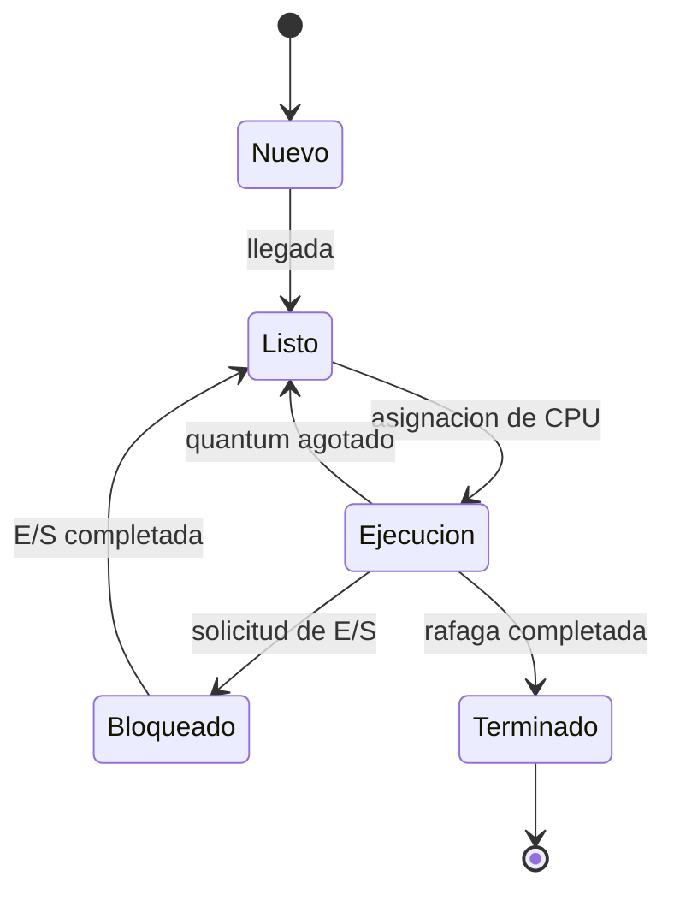

# Estados de un proceso

El reloj del simulador avanza un tick por cada unidad de ejecucion o inactividad.
Una E/S configurada mueve el proceso de Ejecucion a Bloqueado y lo devuelve a
Listo cuando transcurre su duracion. El tiempo de retorno incluye la espera y
el bloqueo; el tiempo de espera excluye la rafaga de CPU y la E/S.
