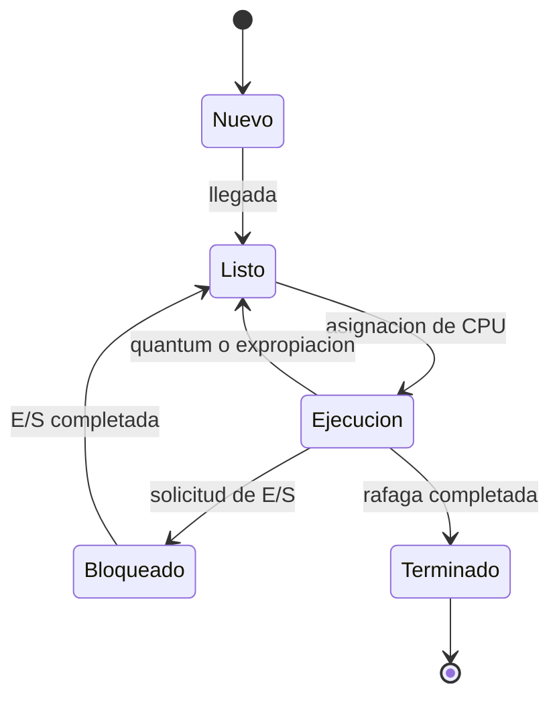

# Estados de un proceso

El reloj avanza un tick por cada unidad de ejecucion o inactividad. Cada
solicitud de E/S mueve al proceso de Ejecucion a Bloqueado y luego a Listo; un
proceso puede repetir ese ciclo varias veces antes de Terminado. El retorno
incluye espera y bloqueo; el tiempo de espera excluye la rafaga y las E/S.
